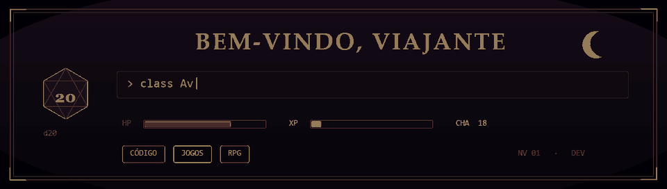

  

# Camila Spangenberg

Estudante de Engenharia de Software na Universidade de Vassouras, em Maricá. Desenvolvo APIs e aplicações web, com backend em Python e interfaces em React.

## Stack

Python · Django · FastAPI · PostgreSQL · MongoDB · Redis · Node.js · Express · React · Docker

## Projetos

| Projeto | Sobre |
| --- | --- |
| [Flow Financeiro](https://github.com/euspan/Flow-Financeiro) | Educação financeira gamificada. React no frontend e API em Node.js, Express, JWT e MongoDB. [Aplicação](https://flow-financeiro-ruddy.vercel.app) |
| [Gestão de Tarefas](https://github.com/euspan/P1-FULL-STACK---GEST-O-DE-TAREFAS) | Django com isolamento por equipe, papéis de admin e operador, API REST e dependências entre subtarefas. |
| [Acervo Biblioteca](https://github.com/euspan/projeto-biblioteca) | Cadastro de livros em Django, classificação CDU e busca por título, tipo e categoria. |
| [API de Pedidos](https://github.com/euspan/BDNR---P2) | FastAPI e MongoDB, com eventos em RabbitMQ e Kafka, testes e Docker Compose. |
| [Redis e FastAPI](https://github.com/euspan/BD---T2) | Cache com TTL, fila produtor-consumidor e worker em background. |
| [API de Produtos](https://github.com/euspan/T2---Backend) | FastAPI, PostgreSQL, SQLAlchemy, Pydantic e testes com Pytest. |

## Contato

GitHub: [euspan](https://github.com/euspan)
